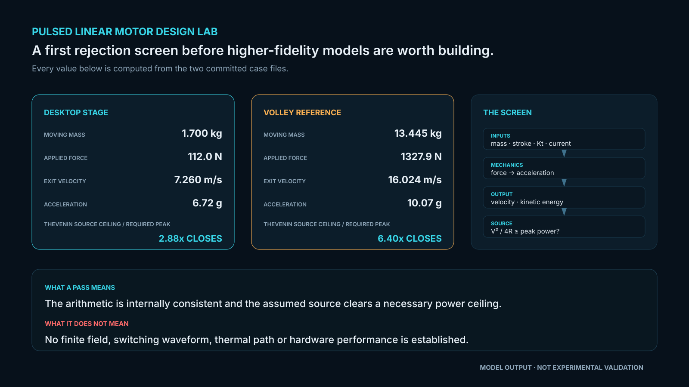
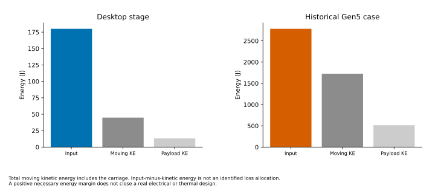
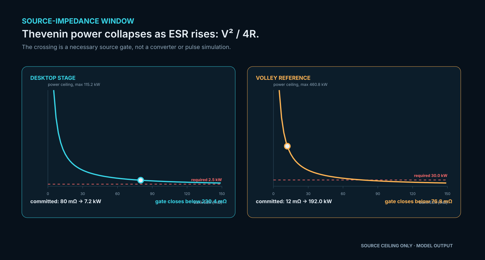
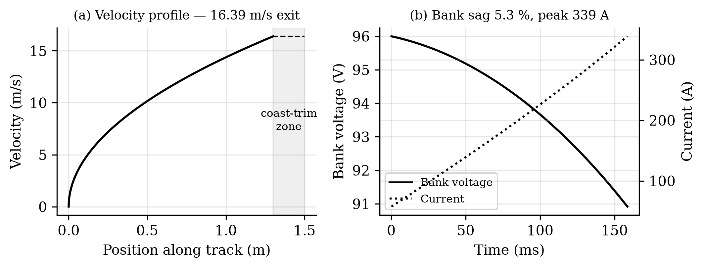

# Pulsed Linear Motor Design Lab

<p align="center"><a href="figures/design-screen.svg"></a></p>

[](https://github.com/aaaaaaaaaaaavm/pulsed-linear-motor-design-lab/actions/workflows/ci.yml)
[](LICENSE)
[](pyproject.toml)
[](docs/PROVENANCE.md)

A focused, installable screening calculator for pulsed linear-motor stages, with the
committed VOLLEY reference calculation and the independent numerical checks that qualify it.

**Status: computational screening tool. Nothing here has been experimentally validated.**
I use it to expose force, stroke, moving-mass, source-impedance and energy trade-offs before
a field or circuit model is worth building. It is not qualification software.

## Why this exists

VOLLEY's full shot model answers a spacecraft-deployer question and carries years of project
history. That is the right engineering record and the wrong reusable interface. I separated
the smaller question that survives outside it:

> Given moving mass, stroke, thrust constant, sheet current, force limit, source voltage and
> ESR, what constant-force velocity is implied, and do total input energy and the source
> peak-power ceiling permit that result?

I kept the original scripts beside the smaller calculator rather than making the extraction
look more independent than it is.

## Historical reference regression

| Quantity | Standalone screen | Detailed VOLLEY reference |
|---|---:|---:|
| Exit velocity | 16.024 m/s | **16.029 m/s** |
| Acceleration | 10.071 g | **10.068 g** |
| Source check at 12 mΩ | closes | modelled assumption |
| Source check at 116 mΩ | **fails** | representative purchasable single string |

The historical Gen5 speed is challenged by a later finite-geometry screen in the main project.
It remains here as a reproducible regression input, not a rated speed.

The velocity difference is 0.005 m/s, inside the declared 0.01 m/s regression band. That is
model-to-model agreement, not a force, current or velocity measurement.

<p align="center">
  <a href="figures/force-energy.svg"></a>
  <a href="figures/source-window.svg"></a>
</p>

<p align="center"><sub>The energy plots distinguish electrical input, total moving kinetic energy and payload
kinetic energy. The source plot compares the Thevenin ceiling with requested peak power.
Both use the two committed cases; no loss allocation or hardware capability is established.</sub></p>

<p align="center"></p>

<p align="center"><sub>The overview is regenerated from both committed case files by
<code>tools/generate_readme_figure.py</code>. The time history is the retained detailed VOLLEY
reference. Both are model output; neither is experimental validation.</sub></p>

A1 remains **PARTIAL** because two declared field bands missed. A8 is retained as a
**superseded ngspice run** and is not presented as current. A10 shows that a purchasable
single supercapacitor string does not source the shot. No motor, bank or track has been built
or measured.

## Independent energy and power gates

`energy_closes` requires electrical input energy to cover **payload plus carriage** kinetic
energy. `source_closes_at_peak` independently checks the Thevenin power ceiling.
`screen_feasible` is true only when both necessary conditions pass. `energy_margin_J`
and `moving_energy_fraction` expose the total moving-energy accounting.

When either gate fails, `exit_velocity_m_s` is a hypothetical force/stroke result and must not
be reported as attainable. Efficiencies above 100% expose an inconsistent input rather than
being clipped or accepted. Zero energy margin is only the ideal lossless boundary; realistic
copper, switching, friction, source and thermal losses need an explicit circuit/dynamic model.
The electrical-input boundary must include all supplied energy and assumes no other energy
source. Passing both gates does not validate a winding, inverter or energy store.

## Run it

```bash
python -m pip install -e .
plmd cases/desktop_stage.json
plmd cases/volley_reference.json --out build/volley_reference.json
```

`desktop_stage.json` is deliberately not a VOLLEY case. It is the check that this is a
reusable interface rather than a renamed project script.

## Verify it

```bash
python -m unittest discover -s tests -v
python tools/verify_repository.py
```

The tests cover the corrected reference point, zero stroke, missing inputs, non-physical
force inputs, the realistic source-impedance failure and the payload-energy bound.

## Repository layout

- `src/plmd/` — the dependency-free screening calculator and command-line entry point;
- `cases/` — one VOLLEY reference case and one independent desktop-stage case;
- `tests/` — limiting cases, rejection paths and the declared regression band;
- `reference/volley/` — files retained byte-for-byte from VOLLEY commit `aa22a06`;
- `docs/` — validation boundary, tool versions, provenance, decisions and roadmap.

Read [validation](docs/VALIDATION.md), [toolchain](docs/TOOLCHAIN.md),
[provenance](docs/PROVENANCE.md), and [open problems](OPEN_PROBLEMS.md) before using a result.

## Licence

**CC BY 4.0** — full text in [`LICENSE`](LICENSE), attribution form in [`NOTICE`](NOTICE).
Attribution requires credit, a link to the licence, and **an indication of whether changes were
made**.

**Not retroactive:** snapshots taken before this change remain available under the MIT licence
they carried at the time, retained at [`LICENSE-MIT-superseded`](LICENSE-MIT-superseded).

This repository carries copies of VOLLEY analysis code under `reference/volley/`. CC BY 4.0 does
not license patent rights, which is why a patent-granting licence was not used here.

## Figure generation

Install `python -m pip install -e ".[figures]"`, then run
`python tools/generate_readme_figure.py`. Figures are plain vector exports of local
case calculations at a 180 mm report width, with 10 pt plot labels and explicit model boundaries.
Each figure is exported as editable SVG, embedded-font PDF and 300 dpi PNG.
The local case files, calculation modules, plotting source and style are recorded in the figure manifest.

[Scientific figures and documentation conventions](docs/FIGURE_STANDARD.md) · [Released figure sources](docs/SCIENTIFIC_FIGURES.json)

## Version and case reference

[Current VOLLEY case boundary](docs/VOLLEY_CASE.md) · [Citation](CITATION.cff) · [License](LICENSE) · [Attribution](NOTICE)

[Publication rules and exact-payload checks](PUBLICATION_POLICY.md)
